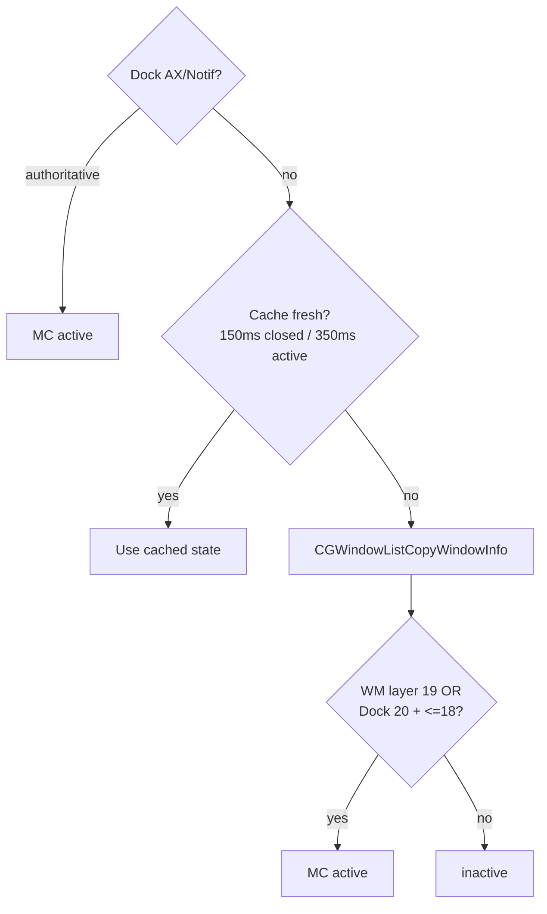

# Mission Control scoping

Every shortcut, gesture, and hover button in MCSC is **scoped to Mission
Control only**. This document explains how the app decides that Mission Control
is active, why the other full-screen layers are excluded, and how it recovers
when macOS gets stuck. The keyboard and gesture behaviors that depend on this
detection live in [SHORTCUTS.md](./SHORTCUTS.md) and
[GESTURES.md](./GESTURES.md).

---

## Why scoping matters

Mission Control, Launchpad, and expanded Finder folder stacks all draw
full-screen overlays. They look similar, but only Mission Control should receive
MCSC's window actions. Firing a close or minimize while Launchpad is open, or
while a Finder folder stack is expanded in the Dock, would act on the wrong
surface. Scoping keeps the app predictable.

---

## How detection works

`MissionControlService` uses a multi-layered approach:

- **Distributed Dock notifications.** It observes names such as
  `com.apple.MissionControl.start` and `com.apple.expose.start`. On current
  macOS versions these notifications often do not reach a standalone process, so
  this is only a fast path, not the source of truth.
- **Authoritative Dock AXObserver transitions.** `MissionControlHoverService`
  listens for Dock AX notifications (`AXExposeShowAllWindows`, `AXExposeExit`) and
  immediately synchronizes state with `MissionControlService.markActive(_:)`.
- **Window-list heuristic (Dock + WindowManager).** It calls `CGWindowListCopyWindowInfo`
  and inspects on-screen window layers:
  - **Modern macOS (macOS 27+ / WindowManager):** Mission Control composition is
    managed by `com.apple.WindowManager`, identified by its full-screen overlay at
    **layer 19** (along with the spaces bar at **layer 14**).
  - **Dock-managed Mission Control:** Mission Control exposes a full-screen Dock
    overlay at **layer 20** together with the Dock bar at **layer 18 or below**.
  - Transitions detected during scans automatically trigger `onActivated` and `onDeactivated` callbacks.

The active result is cached for **350 ms** (`detectionCacheInterval`); while
closed, the cache is capped at **150 ms**, reusing the existing 200 ms detection
poll to notice opening sooner. Gesture frames still share the cache.
Scans also track the overview canvas window IDs. If all canvas IDs change while
the detector remains active, it closes the old tracking session and starts a new
one. This handles a rapid exit/reentry whose closed interval falls between
scans. WindowManager IDs take priority over persistent Dock surfaces.

> [!NOTE]
> The heuristic intentionally excludes look-alikes. **Launchpad** draws its
> overlay at layers 27 to 29, which is above the Mission Control signature. An
> expanded **Finder folder stack** shows only the overlay window and lacks the
> Dock bar or WindowManager signature, so both are correctly ignored.

---

## Activation cooldown

When Mission Control activates, MCSC starts a 0.5-second cooldown. This prevents
the three-finger swipe that opened Mission Control from immediately triggering a
gesture. After the cooldown, gestures and shortcuts respond normally.
The cooldown uses a monotonic deadline, so an earlier session cannot end a new
session's cooldown. Touch-lift frames always clear the previous gesture cycle,
including during cooldown. Hardware contact state survives a tracking-session
restart until actual finger lift or listener shutdown.

---

## Recovery sequence

Mission Control can swallow `Cmd + Space`, leaving macOS in a stuck state. While
Mission Control is open, MCSC repurposes `Cmd + Space` to run a recovery
sequence:

1. It posts `Escape` (key code 53) to dismiss the current overlay.
2. After 0.2 seconds it posts `Cmd + Space` (key code 49) to reopen the correct
   surface.

MCSC sets an `isSimulating` flag around the sequence so it does not react to its
own injected events.

---

## Keyboard Interaction & HID Event Tapping

Capturing keyboard events while Mission Control is open presents a unique macOS challenge:
- **Session-level event taps** (`.sessionEventTap`) fail to receive alphanumeric `keyDown` events because the WindowServer grabs keyboard input for Exposé.
- **Dedicated HID-level event tap:** MCSC installs `MCKeyboardTapService` at `.cghidEventTap` exclusively when Mission Control is active. This captures raw keystrokes before the WindowServer swallows them, enabling real-time fuzzy finding (`WindowSelectionEngine`).
- **Private Exposé SPIs:** MCSC leverages learnings from the open-source community (specifically [OpenMissionControl PR #3](https://github.com/nohackjustnoobb/OpenMissionControl/pull/3/changes)) for handling low-level Exposé states and `CoreDockSendNotification` wake mechanisms.

---

---

## Multi-Space Isolation & macOS 27 Ghosting

### The Ghosting Problem
On modern macOS versions (macOS 27+), Mission Control visual composition is handled by `com.apple.WindowManager` at **layer 19**.
WindowManager retains `AXButton` preview tiles with a `"wid"` (Window ID) attribute in its AX hierarchy for **all desktop spaces simultaneously** at their virtual screen coordinates.

If an application queries WindowManager via `AXUIElementCopyElementAtPosition` without strict space filtering, hit-tests will return hidden/masked preview tiles belonging to windows on other desktop spaces (e.g. hovering over Desktop 2 triggering a close button for a Desktop 1 Ghostty window).

### SkyLight Space Management
To prevent cross-space leakage and maintain zero-footprint performance, `SpaceManagementService` leverages private SkyLight CGS routines:
- `CGSMainConnectionID()`: Resolves the main window server connection.
- `CGSCopyManagedDisplaySpaces(_:)`: Returns current active `ManagedSpaceID` per display.
- `CGSCopySpacesForWindows(_:0x7:_:)`: Inspects space assignment lists for candidate window IDs.

### Invariants for Window Tracking & Gesture Safety
1. **Window List Filtering (`fetchWindows`):** Candidate windows are pruned using `spaceService.isWindowOnCurrentSpace(windowID:)`.
2. **Hit-Test Filtering (`getMissionControlPreviewTile`):** WindowManager AX lookups only match against `matchingWindowIDs` verified to belong to the active desktop space.
3. **Empty Space Lists:** Windows with an empty space list (`[]`) are unassigned or visible across all spaces (such as floating tool windows, Finder panels, or menus) and are permitted on the active space.
4. **No ScrollWheel Space Transitions:** Two-finger trackpad gestures emit `CGEventType.scrollWheel` events with horizontal deltas. The input event tap must NEVER treat `scrollWheel` as a Space transition; doing so prematurely resets hovered window targets and suppresses 2-finger swipe actions. Space transitions are strictly 3+ finger swipes or Ctrl+hotkeys.
5. **Decoupled Target Resolution:** `previewWindow(at:)` must never be guarded by `isSpaceTransitioning`. Only visual overlay rendering (`updateOverlay`) is suppressed during space switches.
6. **Panel Space Membership:** A retained all-Spaces panel can lose membership in the current desktop after desktop/fullscreen changes while `NSWindow.isVisible` remains true. Preview controls require both `isVisible` and `isOnActiveSpace`. Before showing a stranded panel, release it and lazily create a replacement; ordering it forward or reapplying collection behavior does not repair the stale assignment. This uses the existing refresh and adds no polling or persistent cache.

---

## Persistent window labels

Settings → General → Mission Control → **Always Show Window Labels** is an
opt-in preference, independent of Hover Close Button. It displays application
icons and window titles on previews. The preview under the pointer hides only
its custom label, leaving the system's native hover label visible. Moving away
restores that same panel. The existing refresh preserves this hover state,
including after title or appearance changes.

Settings controls label position (top, center, bottom), icon placement (above,
below, left, right), icon size (16–64 pt), and title size (10–20 pt). Changes
apply immediately; Restore Defaults resets the appearance. Native hover labels
retain the system's own appearance.

Labels use real AX preview frames after entry. During entry, the same validated
window IDs can use their live CG bounds to follow the native shrink animation.
Both the preview's Space identifier and its
window's Space assignment must match the display's active Space. Small previews
are retained because macOS can report scaled thumbnail bounds in CG metadata.

Exit keys and ordinary selection clicks hide the panels before passing input to
WindowServer. A dismissal latch prevents the refresh from repainting during the
exit animation. Exit/Space keys are still observed when Keyboard Navigation is
off, without consuming normal typing. Spaces controls and window dragging use
transition suppression; fresh preview geometry must settle before labels return.
Three-or-more-finger contact keeps suppression active until the contact ends,
even when custom gestures are disabled or cooling down. Ordinary two-finger
scrolling does not start this suppression.

Label panels are mouse-transparent, have no window animation, and order out
before resources are released. Panels and icon caches are session scoped.
The feature reuses the existing session refresh; no extra polling timer or heavy
dependency is added. Memory acceptance uses a cold-start baseline below 13 MB,
as confirmed by the user; interaction samples are reported separately.

The native-label-only approach was investigated on macOS 27.0.1. No working
external all-labels control was found in the inspected AX interfaces or
WindowManager preferences. Native labels remain managed by the system; this
feature avoids duplication by hiding the hovered custom label.

Hover actions remain independent of the label preference, including for small
scaled previews. If WindowManager's native hit test returns another Space's
hidden replica, a bounded AX geometry lookup resolves the current display's
active Space. The lookup rejects ambiguous candidates, incomplete traversals,
and unknown active Spaces. It retains no AX tiles between calls. Both the label
panels and close-button panel disable AppKit's window fade, so ordering them out
does not leave a floating button during desktop animations.

### Local validation (2026-10-19)

Validation used macOS 27.0.1 with one attached display and two existing desktops.
Release compilation and static analysis succeeded. Temporary validation tools
were kept outside the repository; no automated test files were added.

- Hover checks cover hiding only the target, restoring it on leave, and keeping
  it hidden through refreshes and while hovering the close button's outer edge.
- Two disposable windows were actually closed through the upper-left button,
  once with labels enabled and once with labels disabled. Mission Control stayed
  open and the other disposable window remained intact.
- CG mouse clicks actually switched between both desktops and added one
  temporary desktop. All overlays cleared in 31–71 ms, before the desktop exit
  animation completed. Adding a desktop restored all labels after about 1.1 s;
  the temporary desktop was removed and the original desktop restored.
- Real WindowManager AX data reproduced a direct hit on an inactive Space. The
  fallback selected the correct current-Space window and rejected wrong Space
  and window IDs. Warm lookups took approximately 5–6 ms on this machine.
- Temporary replay of the actual touch callback, ViewModel frame handler, and
  gesture recognizers passed 143 checks, including all seven gestures and their
  Cmd variants, 3/4-finger suppression, lifting, and repeated gestures. Another
  16 checks covered bounded AX traversal and ambiguous candidates.
- The initial installed build's cold-start `footprint` was 12,829,608 bytes (12.83 MB,
  12.24 MiB), below the agreed 13 MB baseline ceiling. This is a launch sample;
  after repeated Mission Control and Settings interactions, a separate sample
  was 38,667,344 bytes (38.67 MB, 36.88 MiB). It is not a launch-baseline sample.
  `leaks` reported 20,016 bytes rooted in AppIntents/linkd XPC connections, the
  same count and roots as the earlier prototype sample; this is not a claim
  of zero leaks.

External AXPress desktop selection bypasses the input tap; its cleanup timing
must not be treated as evidence of early mouse/keyboard dismissal. Native CG
input paths are validated separately. The user also confirmed on the installed
build that real trackpad gestures work and labels hide promptly when switching
desktops and leaving Mission Control. The disposable test process was removed
after that confirmation.
Multiple attached displays were not available for hardware validation.

### Entry latency optimization (2026-10-19)

The initial layout gate required matching preview geometry for at least 200 ms,
but could only confirm it on the existing 500 ms window poll. This delayed both
the icon and title. Loading icons for nine running applications took about
7–10 ms in fresh probe processes on this machine; system icon caches were warm.

That version advanced the existing timer's deadline up to three times. It
required two matching snapshots separated by at least 200 ms and waited at
least 350 ms after activation. It retained the exit, Space transition, drag, and
gesture guards and the normal 500 ms interval. The following update replaces
this initial waiting strategy.

- Three repeated entries per build measured a median of 779 ms before and
  636 ms after this change, approximately 18% shorter. The first entry in the
  newly launched process measured 499 ms. These are local samples from the first
  WindowManager canvas to visible, AX-mapped label panels, sampled every 20 ms
  with 12–13 mapped labels; they do not separately measure icon pixel painting.
- The optimized installed build's cold-start footprint was 12,665,720 bytes
  (12.67 MB, 12.08 MiB), below the agreed 13 MB launch-baseline ceiling.
- Temporary checks of the actual entry scheduler passed 18 cases, including
  bounded rescheduling, unchanged timer identity/interval, gesture suppression,
  changed geometry, and cleanup. A real Foundation run-loop check also confirmed
  rescheduling from inside the repeating timer callback.
- Hover regression passed. Native clicks switched desktops in both directions
  and added a temporary desktop; labels cleared in 34–42 ms and recovered after
  the add layout settled. The temporary desktop was removed.
- Escape sent 85 ms and 254 ms after the first canvas exercised early exit.
  Neither case displayed labels after exit during more than three seconds of
  observation. The helper was started before entry to exclude process startup
  from the requested 80/250 ms input delays.

Release compilation and static analysis succeeded again. These checks used the
same single-display setup; the earlier physical trackpad confirmation remains
the hardware gesture validation. All temporary automation stays outside the
repository.

### Animation following and rapid reentry (2026-10-20, earlier revision)

The animation-following presentation below was subsequently replaced by the
fixed-destination presentation described in the next section. These timings
and samples describe that earlier installed revision.

Native sampling showed that AX previews expose their final geometry before the
animation, whereas same-window CG bounds track the moving previews. Entry now
draws labels at those live bounds after checking AX window identity, active
Space, on-screen visibility, finite size, and screen membership. The existing
timer can advance at up to 30 Hz for at most 0.7 seconds and 24 advances. Once
all matched CG bounds reach their AX frames within 2 pt, normal AX rendering
and the 500 ms interval resume. Untrusted or overdue entry geometry falls back
to the stable AX path. Titles and measured text widths reuse existing panels;
icons and titles are still released at session end.

Exit intent, Space changes, dragging, and three-or-more-finger gestures cancel
this entry following. Their suppression and stable-layout recovery take
priority. An opening trackpad gesture therefore retains these guards; its
timing is not the same as LaunchServices opening without trackpad contact.

A reproduced rapid reentry changed the native canvas ID but retained the old
active cache and dismissal latch: labels stayed absent for over five seconds.
Canvas identity now rebuilds that session even without an inactive sample.
Gesture fixes also preserve finger-lift cleanup during cooldown, use a deadline
for each activation's cooldown, and set overview suppression before the first
fetch when three fingers are already down.

In a local comparison of three repeated entries per build, first visible label
panels improved from a 760 ms median to 221 ms (about 71% shorter); all final
mapped labels appeared at a 259 ms median. The first entry in the newly launched
process showed its first label at 270 ms and all mapped labels at 329 ms.
Measurements start at the first visible native canvas and sample every 20 ms;
they measure mapped panel visibility, not independent icon pixel painting.
Local entry video also showed labels moving with previews during entry.

The installed build's cold-start footprint was 12,944,296 bytes (12.94 MB,
12.34 MiB), below the agreed 13 MB launch-baseline ceiling.

Final local validation passed 182 gesture/lifecycle checks, 39 detector checks,
and 45 entry-following checks using temporary tools outside the repository.
Actual UI automation passed 12 hover, 22 exit, 52 desktop-click/add, and 26
disposable-window close checks. Native desktop operations cleared labels in
31–52 ms. Five rapid reentries (requested gaps 0, 0, 30, 80, 150 ms) all restored
labels within 188–345 ms of the new canvas, without labels during the closed
interval. Escape during entry at 80/250 ms prevented later labels; at 350/450 ms
already-visible labels cleared within 46–51 ms and never returned during or
after the exit animation. The disposable helper was stopped, the temporary
desktop removed, and the original desktop restored.

Release compilation and static analysis succeeded. After the interactive
regression run, footprint was 39,207,968 bytes (39.21 MB, 37.39 MiB); this is a
separate interaction sample, not the cold baseline. The earlier physical
trackpad confirmation remains the hardware validation; the latest gesture
changes were exercised through actual-source replay. Multiple attached
displays were not available.

**Local installation permission:** the automation launch inherited Codex's
existing Accessibility authorization. A separate normal LaunchServices launch
was explicitly checked and was not trusted by macOS after the ad-hoc rebuild.
Refreshing MCSC's permission required an administrator-password dialog, so that
step remains pending. After the next startup, open System Settings → Privacy
& Security → Accessibility (Device Control and Data Access on this system),
remove the old MCSC entry if necessary, add `/Applications/MCSC.app`, and enable
it. The installed binary and source are saved; normal standalone operation
requires completing that OS authorization. Validation summaries are also saved
under `~/Library/Logs/MCSC/entry-reentry-validation-20261020/`.

### Fixed entry placement, drag retention, and close recovery (2026-10-20)

Entry labels now use the AX destination frame immediately. Live CG window
bounds no longer move the icon/title panels along the native zoom animation.
The existing bounded early refresh (0.7 seconds, at most 24 advances) remains
available for initially incomplete AX snapshots and stops once the layout has
been unchanged for 200 ms. Finishing entry does not remove visible panels.
Settings position, icon placement, icon size, and title size remain unchanged.

A press on a preview hides only that preview's label. During a held drag, the
other panels retain their positions and visibility, even when the dragged
window crosses another preview. Refreshes skip transient AX layouts while the
mouse is held. A native preview selection hides all overlays synchronously on
mouse-up, before the event reaches WindowServer. A drop uses the existing
Space/layout stabilization path. Native exit, desktop transitions, and overview
gestures retain priority over drag retention.

Two recoverable failure paths were identified for the close button: an initial
AX snapshot can omit the stationary pointer's target without another mouse
move to trigger resolution; a native panel can be hidden while the old stored
visibility flag still says it is visible. The existing window-fetch callback
now retries the current target, while panel visibility reads the actual
NSPanel state. Hidden-panel hit rectangles no longer swallow clicks or hold
preview hysteresis. The visible close button remains a valid mouse target
during these retries. No additional persistent timer or dependency was added.

Temporary actual-source validation outside the repository passed 15 drag and
entry-state checks, 10 timer/retry guards, fixed-frame selection with three
changing CG frames, and three real NSPanel visibility/geometry checks. The
original variants failed the drag, fixed-frame, stationary-pointer retry, and
native-hidden-panel checks before the fixes. Real UI validation retained 15
other labels through mouse-down and held dragging; 12 repeated sessions with a
stationary pointer each recovered one close button. A separate read-only code
review found no confirmed critical or important issues. Release compilation
and static analysis succeeded. Further UI and installation results are
recorded with the local validation artifacts.

Cold-launch memory was compared under matching current desktop conditions.
Without the disposable helper, the installed reference reached 13,206,416
bytes and the candidate 13,091,752 bytes at both 10 and 20 seconds after launch.
The candidate decreased this sample by 114,664 bytes, but both exceed the
strict 13,000,000-byte launch ceiling in this environment. The memory gate is
therefore not recorded as passing; historical lower samples above are not
substituted for this measurement.

### Window controls and deliberate application quit (2026-10-20)

Mission Control previews now offer separate close, minimize, and fullscreen
symbols in one lazily created panel. Settings → General → Mission Control →
Button Size scales both the visible symbols and their larger adjacent hit
cells from 75–200% (default 125%, giving each control a 50-point hit cell).
The primary X retains its modifier actions. An unmodified quick tap lasting
at most 0.25 seconds closes only the target window. Holding for 0.75 seconds
from mouse-down requests a normal application quit. Releasing between 0.25 and 0.75 seconds
cancels both actions. Application confirmation for unsaved documents remains
in control of the owning application. Gesture-based window closing remains
available.

The first 0.25 seconds show no progress ring or press shake. After that grace
period, a thin ring fades in around X and fills clockwise from 12 o'clock over
the remaining 0.5 seconds, while symbol-only motion gradually increases at
nine cycles per second. Cancellation retracts the ring and
damps the symbol's position and velocity over 280 ms, then fades the track for
100 ms. A new press always receives a full 0.75 seconds. Exit and panel hiding reset
all press feedback immediately. Two Core Animation shape layers are created
only for the first press; no persistent animation timer or display link is used.

On this macOS version, AXFullScreen requests made inside Mission Control return
success without changing fullscreen state. Preview fullscreen now dismisses
Mission Control first, waits for native inactivity with a bounded weak callback,
and verifies the original desktop, window ID, and owner PID before acting.
Reentry or service stop invalidates the pending request.

Settings → General → Behavior → Enlarge Window Button Hit Areas independently
expands normal-window traffic-light hit areas from 100–300% (default 160%).
This reuses the existing event tap and resolves native controls only on a
mouse-down near the title bar. Actual button clicks retain native handling;
expanded margins resolve overlapping candidates by nearest center and never
extend outside the window. Dragging out, disabled controls, overview entry,
and service stop cancel the pending margin click. MCSC's own AppKit windows
use local standard buttons to avoid querying their AX hierarchy on the same
main thread.

Release build and static analysis passed. Temporary actual-source checks
passed 12 press-state cases, 36 hold-service cases, 15 drag/entry guards, 10
refresh guards, native hit-area cases, and animation direction, bounds,
zero-crossing damping, and reset checks. Real UI checks verified early-release
cancellation, one application quit per hold, declined quits, cancellation on
exit, restored labels, all three controls, ordinary native margins, and return
from fullscreen to the original desktop. Twelve repeated overview sessions
restored X at a stationary pointer. Settings UI changes persisted and changed
the panel from 150×50 to 180×60 points at 150%, then restored the 125% default.
No test files were added to the repository. The signed Release bundle was
installed at `/Applications/MCSC.app`; the prior bundle is preserved under
`~/Library/Application Support/MCSC/Backups/`.

Final cold samples without the helper were 13,222,800 bytes at 3 seconds and
13,075,344 bytes at 10, 20, and 30 seconds, with overview closed throughout.
This remains below the matched installed reference (13,206,416 bytes), but
exceeds the strict decimal 13,000,000-byte gate by 75,344 bytes. The strict
memory gate has not passed. A one-shot allocator-reclamation experiment did
not improve memory and was removed. Normal LaunchServices startup of the
newly ad-hoc-signed bundle needs renewed macOS Accessibility permission;
the installed bundle's final hold UI validation used Codex's existing
authorization and passed all 32 checks. The final `leaks` scan reported 20,016
bytes in three Apple `com.apple.linkd.autoShortcut` XPC connection cycles.
It did not identify MCSC objects as cycle roots; this result is not recorded
as a zero-leak pass. Validation evidence
is saved under `~/Library/Logs/MCSC/controls-validation-20261020/`.

The subsequent compatibility update passed 20 press-boundary checks, 39
hold-service checks, 32 actual UI checks, and a real AppKit presentation-layer
check. At 0.104 and 0.210 seconds ring opacity and progress were both zero;
at 0.423 and 0.629 seconds progress increased normally. Partial release
retracted visibly, and release during the grace period removed the scheduled
animations without a later flash. Tap close, cancelled partial hold, app quit,
declined quit, pointer cancellation, and exit/reentry all passed.

The pre-compatibility bundle was reauthorized and ordinary LaunchServices
startup reported Accessibility trusted and hover tracking active. The later
compatibility bundle changed the local ad-hoc signature again and was also
reauthorized. Its independent LaunchServices process subsequently reported
Accessibility trusted and hover tracking active; it no longer requires the
Codex launch context. All 32 compatibility UI checks then passed in that
independently launched process, and the disposable helper was stopped.
Its separate cold candidate sample was
13,124,496 bytes; the strict decimal 13 MB gate remains unmet. Compatibility
validation evidence is saved under
`~/Library/Logs/MCSC/compatible-controls-validation-20261020/`.

## Source references

- Detection heuristic and caching: `../MCSC/Services/MissionControl/MissionControlService.swift`
- Space management & SkyLight isolation: `../MCSC/Services/MissionControl/SpaceManagementService.swift`
- Dedicated HID Key Tap: `../MCSC/Services/MissionControl/MCKeyboardTapService.swift`
- Fuzzy Selection Engine: `../MCSC/Models/WindowSelectionEngine.swift` & `WindowSearchSession.swift`
- Window Activation Actions: `../MCSC/Models/Actions/WindowActivationAction.swift` & `MissionControlWindowActions.swift`
- Search Overlay View: `../MCSC/Views/SearchBarOverlay.swift`
- Cooldown hook: `../MCSC/ViewModels/ShortcutViewModel.swift` (`onActivated`)
- Scoped delivery of gestures: `../MCSC/Services/Multitouch/MultitouchService.swift`
- Scoped delivery of shortcuts: `../MCSC/Services/EventTap/EventTapService.swift`
- Hover tracking & search session orchestration: `../MCSC/Services/MissionControl/MissionControlHoverService.swift`

#### Visual — Detection Flow

| Surface | Layers / Process | Result |
|---------|------------------|--------|
| Mission Control (macOS 27+) | `WindowManager` layer 19 | ✅ active |
| Mission Control (Classic) | `Dock` layer 20 + ≤18 | ✅ active |
| Launchpad | `Dock` layers 27-29 | ❌ inactive |
| Finder folder stack | only overlay (no Dock bar / WM overlay) | ❌ inactive |

